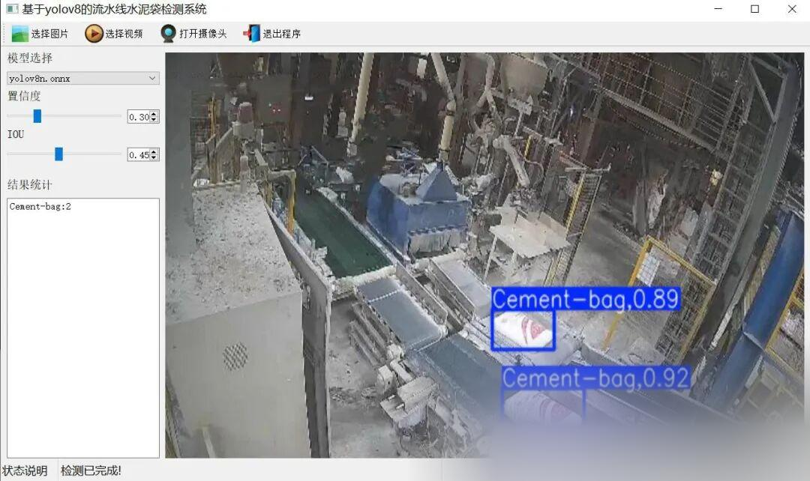

# Pipeline Cement Bag Detection System Based on Yolov8 in Python Source Code + ONNX Model + Evaluation Indicator Curve + High-quality GUI Interface

[Algorithm Introduction]

A pipeline cement bag detection system based on YOLOv8 is an automated detection system that utilizes advanced artificial intelligence technology. This system achieves efficient and accurate detection of cement bags in the pipeline by deploying the YOLOv8 object detection model.

YOLOv8, as a leading target detection system, has won widespread attention for its excellent speed and accuracy. This system can analyze image data on the production line in real-time, quickly and accurately identify the location and quantity of cement bags. Through training and optimization, the YOLOv8 model can adapt to different lighting conditions, shooting angles, and background complexity, ensuring stability and reliability in practical applications.

In the assembly line cement bag inspection system, the application of the YOLOv8 model has greatly improved the efficiency and accuracy of detection, reduced the cost and risk of manual intervention. The system can automatically identify and classify cement bags, providing strong data support for subsequent production and management. At the same time, the system also has scalability and flexibility, which can be customized and optimized according to actual needs, meeting the application needs in different scenarios.

In summary, the YOLOv8-based pipeline cement bag detection system is an efficient, accurate, and reliable automated detection solution. Its application will help improve the level of automation and product quality in cement bag production, providing strong support for the intelligent process in the cement industry. Additionally, this system also serves as a reference for other similar industrial detections, promoting the development of intelligent manufacturing.

[Effect Display]



[Project Number]

[Test Environment]

windows10
anaconda3+python3.8
torch==1.9.0+cu111
ultralytics==8.3.21

The model can detect the category.

Cement-bag

[Training Dataset]

[Dataset] [Object Detection] Smart Factory Line Cement Bag Detection Dataset VOC+YOLO format, 1787 images in 1 category - CSDN Blog

[Training Information]

| Parameter | Value |
| ----------- | -------- |
| Training set images count | 1322 |
| Validation set images count | 308 |
| Training map | 99.5% |
| Training precision (Precision) | 99.1% |
| Training recall rate (Recall) | 100.0% |

###### Validation set test accuracy information

|

Category

 ||

MAP50 (unit:%)

 |
|

all

 ||

99

 |
| Cement-bag ||

99

 |

[Partial Implementation Source Code]

-
-
-
-
-
-
-
-
-
-
-
-
-
-
-
-
-
-
-
-
-
-
-
-
-
-
-
-
-
-
-
-
-
-
-
-
-
-
-
-
-
-
-
-
-
-
-
-
-
-
-
-
-
-
-
-
-
-
-
-
-
-
-
-
-
-
-
-
-
-
-
-
-
-
-
-
-
-
-
-
-
-
-
-
-
-
-
-
-
-
-
-
-
-
-
-
-
-
-
-
-
-
-
-
-
-
-
-

```
class Ui_MainWindow(QtWidgets.QMainWindow):    signal = QtCore.pyqtSignal(str, str)     def setupUi(self):        self.setObjectName("MainWindow")        self.resize(1280, 728)        self.centralwidget = QtWidgets.QWidget(self)        self.centralwidget.setObjectName("centralwidget")         self.weights_dir = './weights'         self.picture = QtWidgets.QLabel(self.centralwidget)        self.picture.setGeometry(QtCore.QRect(260, 10, 1010, 630))        self.picture.setStyleSheet("background:black")        self.picture.setObjectName("picture")        self.picture.setScaledContents(True)        self.label_2 = QtWidgets.QLabel(self.centralwidget)        self.label_2.setGeometry(QtCore.QRect(10, 10, 81, 21))        self.label_2.setObjectName("label_2")        self.cb_weights = QtWidgets.QComboBox(self.centralwidget)        self.cb_weights.setGeometry(QtCore.QRect(10, 40, 241, 21))        self.cb_weights.setObjectName("cb_weights")        self.cb_weights.currentIndexChanged.connect(self.cb_weights_changed)         self.label_3 = QtWidgets.QLabel(self.centralwidget)        self.label_3.setGeometry(QtCore.QRect(10, 70, 72, 21))        self.label_3.setObjectName("label_3")        self.hs_conf = QtWidgets.QSlider(self.centralwidget)        self.hs_conf.setGeometry(QtCore.QRect(10, 100, 181, 22))        self.hs_conf.setProperty("value", 25)        self.hs_conf.setOrientation(QtCore.Qt.Horizontal)        self.hs_conf.setObjectName("hs_conf")        self.hs_conf.valueChanged.connect(self.conf_change)        self.dsb_conf = QtWidgets.QDoubleSpinBox(self.centralwidget)        self.dsb_conf.setGeometry(QtCore.QRect(200, 100, 51, 22))        self.dsb_conf.setMaximum(1.0)        self.dsb_conf.setSingleStep(0.01)        self.dsb_conf.setProperty("value", 0.25)        self.dsb_conf.setObjectName("dsb_conf")        self.dsb_conf.valueChanged.connect(self.dsb_conf_change)        self.dsb_iou = QtWidgets.QDoubleSpinBox(self.centralwidget)        self.dsb_iou.setGeometry(QtCore.QRect(200, 160, 51, 22))        self.dsb_iou.setMaximum(1.0)        self.dsb_iou.setSingleStep(0.01)        self.dsb_iou.setProperty("value", 0.45)        self.dsb_iou.setObjectName("dsb_iou")        self.dsb_iou.valueChanged.connect(self.dsb_iou_change)        self.hs_iou = QtWidgets.QSlider(self.centralwidget)        self.hs_iou.setGeometry(QtCore.QRect(10, 160, 181, 22))        self.hs_iou.setProperty("value", 45)        self.hs_iou.setOrientation(QtCore.Qt.Horizontal)        self.hs_iou.setObjectName("hs_iou")        self.hs_iou.valueChanged.connect(self.iou_change)        self.label_4 = QtWidgets.QLabel(self.centralwidget)        self.label_4.setGeometry(QtCore.QRect(10, 130, 72, 21))        self.label_4.setObjectName("label_4")        self.label_5 = QtWidgets.QLabel(self.centralwidget)        self.label_5.setGeometry(QtCore.QRect(10, 210, 72, 21))        self.label_5.setObjectName("label_5")        self.le_res = QtWidgets.QTextEdit(self.centralwidget)        self.le_res.setGeometry(QtCore.QRect(10, 240, 241, 400))        self.le_res.setObjectName("le_res")        self.setCentralWidget(self.centralwidget)        self.menubar = QtWidgets.QMenuBar(self)        self.menubar.setGeometry(QtCore.QRect(0, 0, 1110, 30))        self.menubar.setObjectName("menubar")        self.setMenuBar(self.menubar)        self.statusbar = QtWidgets.QStatusBar(self)        self.statusbar.setObjectName("statusbar")        self.setStatusBar(self.statusbar)        self.toolBar = QtWidgets.QToolBar(self)        self.toolBar.setToolButtonStyle(QtCore.Qt.ToolButtonTextBesideIcon)        self.toolBar.setObjectName("toolBar")        self.addToolBar(QtCore.Qt.TopToolBarArea, self.toolBar)        self.actionopenpic = QtWidgets.QAction(self)        icon = QtGui.QIcon()        icon.addPixmap(QtGui.QPixmap(":/images/1.png"), QtGui.QIcon.Normal, QtGui.QIcon.Off)        self.actionopenpic.setIcon(icon)        self.actionopenpic.setObjectName("actionopenpic")        self.actionopenpic.triggered.connect(self.open_image)        self.action = QtWidgets.QAction(self)        icon1 = QtGui.QIcon()        icon1.addPixmap(QtGui.QPixmap(":/images/2.png"), QtGui.QIcon.Normal, QtGui.QIcon.Off)        self.action.setIcon(icon1)        self.action.setObjectName("action")        self.action.triggered.connect(self.open_video)        self.action_2 = QtWidgets.QAction(self)        icon2 = QtGui.QIcon()        icon2.addPixmap(QtGui.QPixmap(":/images/3.png"), QtGui.QIcon.Normal, QtGui.QIcon.Off)        self.action_2.setIcon(icon2)        self.action_2.setObjectName("action_2")        self.action_2.triggered.connect(self.open_camera)         self.actionexit = QtWidgets.QAction(self)        icon3 = QtGui.QIcon()        icon3.addPixmap(QtGui.QPixmap(":/images/4.png"), QtGui.QIcon.Normal, QtGui.QIcon.Off)        self.actionexit.setIcon(icon3)        self.actionexit.setObjectName("actionexit")        self.actionexit.triggered.connect(self.exit)         self.toolBar.addAction(self.actionopenpic)        self.toolBar.addAction(self.action)        self.toolBar.addAction(self.action_2)        self.toolBar.addAction(self.actionexit)         self.retranslateUi()        QtCore.QMetaObject.connectSlotsByName(self)        self.init_all()
```

[Usage Steps]

Usage Steps:
1. Install the YOLOv8 environment according to the official framework ultralytics installation tutorial, and install PyQt5.
2. Switch to the YOLOv8 environment you have installed, and switch to the source code directory. Then, execute python main.py to start the interface and perform the corresponding operations.

[Provided Files]

Python source code
YOLOv8n.onnx model (without PyTorch model)
Training map, P, R curves (in weights\results.png)
Test images (under test_img folder)


## Payment

Here is a pay link on Stripe ( https://buy.stripe.com/3cs8yP7sY87d0vu9AB ). Please contact me lonlonago@foxmail.com after funding $89, and I will send you a complete data files , thank you!


